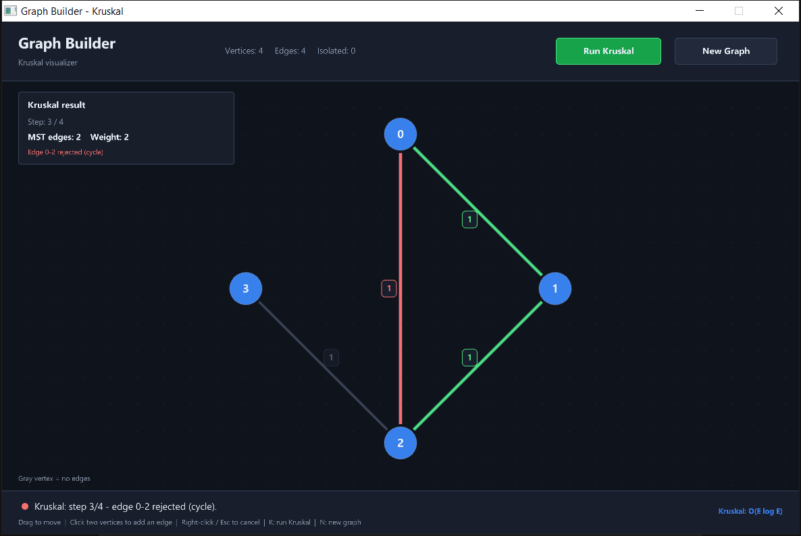

# Kruskal's Minimum Spanning Tree in C++

> Part of the [Data Structures and Algorithms in C++](../../README.md) collection.

> **Author's note:** The graph model, DSU, and Kruskal algorithm were written by me (Mahdi Arjmandi). The raylib UI was generated with AI. See the [AI Assistance](../../README.md#ai-assistance) section in the main README.

> **Status:** Kruskal and the DSU are implemented in `graph.h` and visualized in the GUI. The console entry point in `main.cpp` is still a placeholder.

## Overview

A **minimum spanning tree (MST)** of a connected, weighted, undirected graph is a set of edges that connects all vertices, contains no cycles, and has the smallest possible total weight. A spanning tree on `V` vertices always has exactly `V - 1` edges.

Kruskal's algorithm:

1. Sort all edges by weight.
2. Start with every vertex in its own component.
3. Take the next smallest edge.
4. If it connects two different components, accept it and merge the components.
5. If it would create a cycle, reject it.
6. Stop after `V - 1` edges are accepted.

The "are these two vertices already connected?" question is answered by a **disjoint set union (DSU)**, also called union-find.

## Preview



*Rejected edges are red only during the step that checks them; they return to normal on the next step. Accepted MST edges stay green.*

## Files

| File | Purpose |
| --- | --- |
| [`graph.h`](graph.h) | `Edge`/`Graph`, DSU, connectivity check, and Kruskal |
| [`gui.cpp`](gui.cpp) | raylib graph builder and Kruskal visualizer |
| [`main.cpp`](main.cpp) | Placeholder for a console entry point |
| [`build_gui.bat`](build_gui.bat) | Windows/MinGW build script |

`gui.exe` is ignored by `.gitignore` and is not committed.

## Build and Run

Requirements: Windows, MinGW-w64 `g++` with C++17, and raylib 6.2.

```bat
cd Algorithms\kruskal
build_gui.bat
gui.exe
```

The build script defaults to `RAYLIB_HOME=D:\toll\raylib-6.2-ucrt` and `D:\toll\mingw64\bin\g++.exe`. Set `RAYLIB_HOME` if raylib is installed elsewhere.

Useful switches:

```bat
gui.exe --demo          REM demo graph: 6 vertices, 6 edges
gui.exe --smoke-test    REM draw 30 frames and exit
```

## Using the GUI

- Choose `1` to `30` vertices, then create the graph.
- Click two vertices, enter a positive integer weight, and add the edge.
- Click **Run Kruskal** or press **K**.
- Before running, the GUI calls `is_connected`. If the graph is not connected, Kruskal does not run and a red message is shown.

| Color | Meaning |
| --- | --- |
| Yellow | The edge currently being checked |
| Green | Accepted MST edge (stays green) |
| Red | Rejected because it would create a cycle (red only for that step) |
| Faded | Not checked yet, or not checked because the MST was already complete |

The result panel shows the current step, accepted MST edges, accumulated weight, and the current decision. At the end it shows the final MST and its total weight. Adding an edge or starting a new graph clears the result.

In the six-vertex demo, the only non-MST edge (weight `10`) is never checked because the MST is complete first, so the demo has no red step. To see the transient red highlight, use a graph where a cycle edge is checked before completion, for example a square with a diagonal:

```text
0-1 (1)
1-2 (2)
0-2 (3)   <- rejected
2-3 (4)
3-0 (5)
```

## How Kruskal Is Implemented

### Graph model and DSU

```cpp
struct Edge {
    int src;
    int dest;
    int weight;
};

struct Graph {
    int V;
    vector<Edge> edges;
};

struct DSU {
    vector<int> parent;
    vector<int> dsu_rank;
};
```

`initialize` gives every vertex its own parent and rank zero. `findd` uses path compression, and `unite` merges components by rank:

```cpp
int findd(DSU& dsu, int vertex) {
    if (dsu.parent[vertex] != vertex) {
        dsu.parent[vertex] = findd(dsu, dsu.parent[vertex]);
    }
    return dsu.parent[vertex];
}

void unite(DSU& dsu, int vertex1, int vertex2) {
    int root1 = findd(dsu, vertex1);
    int root2 = findd(dsu, vertex2);

    if (root1 == root2) return;

    if (dsu.dsu_rank[root1] < dsu.dsu_rank[root2]) {
        dsu.parent[root1] = root2;
    } else if (dsu.dsu_rank[root1] > dsu.dsu_rank[root2]) {
        dsu.parent[root2] = root1;
    } else {
        dsu.parent[root2] = root1;
        dsu.dsu_rank[root1]++;
    }
}
```

A cycle exists exactly when `findd(dsu, src) == findd(dsu, dest)`. With path compression and union by rank, both operations are **O(α(V))** amortized.

### Kruskal

The algorithm returns every decision, not only the final MST:

```cpp
struct KruskalStep {
    Edge edge;
    int status;   // 1 = accepted, 0 = rejected
};
```

```cpp
vector<KruskalStep> kruskal(const Graph& graph) {
    vector<Edge> sorted_edges = graph.edges;
    vector<KruskalStep> steps;
    int accept = 0;

    sort(sorted_edges.begin(), sorted_edges.end(),
         [](const Edge& a, const Edge& b) {
             return a.weight < b.weight;
         });

    DSU dsu;
    initialize(dsu, graph.V);

    for (const Edge& edge : sorted_edges) {
        if (findd(dsu, edge.src) != findd(dsu, edge.dest)) {
            steps.push_back({edge, 1});
            unite(dsu, edge.src, edge.dest);
            accept++;
        } else {
            steps.push_back({edge, 0});
        }

        if (accept == graph.V - 1) {
            break;
        }
    }

    return steps;
}
```

Key points:

- `sorted_edges` is a copy; the original graph is unchanged.
- The MST is the accepted steps (`status == 1`); a separate `mst` vector is not needed.
- `accept` counts MST edges, so the `break` is based on accepted edges, not on `steps.size()`.
- Edges after the `break` are **not checked**; they are neither accepted nor rejected.

### Example trace

Graph: `0-1(1)`, `1-2(2)`, `0-2(3)`, `2-3(4)`, `3-0(5)`.

| Step | Edge | Weight | Same component? | Decision |
| --- | --- | --- | --- | --- |
| 1 | `0-1` | 1 | No | Accepted |
| 2 | `1-2` | 2 | No | Accepted |
| 3 | `0-2` | 3 | Yes (`0-1-2`) | Rejected |
| 4 | `2-3` | 4 | No | Accepted; MST complete |
| — | `3-0` | 5 | Not checked | — |

Accepted edges: `0-1`, `1-2`, `2-3`. Total weight: `1 + 2 + 4 = 7`. Checked decisions: 4; rejected: 1.

### Connected and disconnected graphs

`kruskal` works on a disconnected graph too: it returns a **minimum spanning forest**, with fewer than `V - 1` accepted edges. The GUI is stricter and calls `is_connected` before running; if the graph is disconnected, it stops and shows a message.

Do not confuse `is_connected` with `unuse_vertex`:

- `unuse_vertex` returns vertices with no incident edge (`O(V × E)`).
- `is_connected` checks whether the whole graph is one component using DSU (`O((V + E) α(V))`).

A graph can have no isolated vertices and still be disconnected, for example `0-1` and `2-3`. That is why the GUI uses `is_connected` before Kruskal.

## Complexity and Function Reference

| Function | Behavior | Time |
| --- | --- | --- |
| `create_graph(int)` | Creates a graph with `V` vertices and no edges | `O(1)` |
| `add_edge(Graph&, int, int, int)` | Appends one edge; no validation | `O(1)` amortized |
| `edge_exists(const Graph&, int, int)` | Checks both orientations of an undirected edge | `O(E)` |
| `unuse_vertex(Graph&)` | Returns vertices with no incident edge | `O(V × E)` |
| `initialize(DSU&, int)` | Creates one component per vertex | `O(V)` |
| `findd(DSU&, int)` | Finds the root with path compression | `O(α(V))` |
| `unite(DSU&, int, int)` | Merges two components using union by rank | `O(α(V))` |
| `is_connected(const Graph&)` | True when all vertices share one DSU root | `O((V + E) α(V))` |
| `kruskal(const Graph&)` | Returns accepted/rejected decisions in sorted order | `O(E log E)` |

**Kruskal total:** `O(E log E)` time, `O(V + E)` space; sorting dominates. Kruskal is a good fit for sparse graphs, while Prim is often preferred for dense graphs.

## Notes and Limitations

- `main.cpp` is still empty; the console version is not implemented yet.
- The GUI allows at most 30 vertices and positive integer weights.
- `add_edge` performs no validation; the GUI checks self-loops, duplicate edges, and weights.
- There is no edge deletion, weight editing, undo, save, or load.
- Rejected edges are red only for their step; unchecked edges remain faded.
- The UI is AI-generated; the graph model, DSU, connectivity check, and Kruskal implementation are the author's work.

## Status

**Implemented:** graph model, DSU, true connectivity check, Kruskal with accepted/rejected decisions, graph builder GUI, MST highlighting, step animation, transient red rejection, connected-graph guard.

**Not yet:** console entry point, edge deletion/weight editing, save/load, automated test suite.
