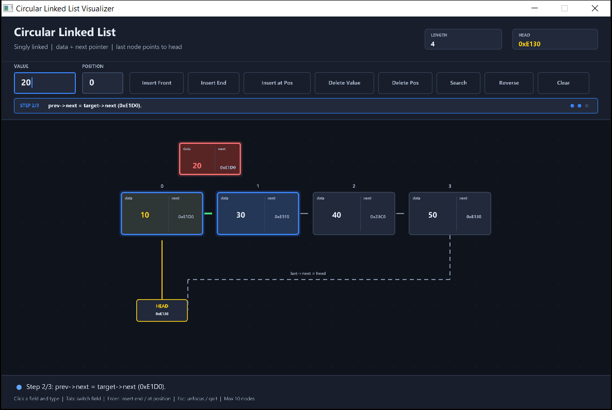

# Circular Linked List in C++

> Part of the [Data Structures and Algorithms in C++](../../README.md) collection.

> **Author's note:** The linked-list operations were written by me (Mahdi Arjmandi). The raylib UI was generated with AI. See the [AI Assistance](../../README.md#ai-assistance) section in the main README.

> **Version:** CLI + UI. The CLI remains the reference implementation. The raylib GUI uses an exact copy of the same operations from `circular-linked-list.h`; `circular-linked-list.cpp` is unchanged.

## Overview

A **circular linked list** is a singly linked list whose last node points back to the first node instead of storing `NULL`. Starting from `head`, a traversal never reaches a null pointer; it eventually returns to `head`. That makes it possible to walk the list repeatedly without restarting from the beginning.

This implementation stores integers in a global singly linked list and provides insertion, deletion, search, reversal, length, position-based operations, and display through an interactive console menu.

## Preview



*Teaching view during Delete Value: the target node is shown in red above the row while step 2 explains `prev->next = target->next`. Every card shows `data` and the address stored in `next`; the HEAD card and the dashed last-to-head arrow show the circular structure.*

## Files

| File | Purpose |
| --- | --- |
| [`circular-linked-list.cpp`](circular-linked-list.cpp) | Complete CLI implementation: node structure, operations, and menu. Unchanged by the GUI. |
| [`circular-linked-list.h`](circular-linked-list.h) | Exact copy of the list operations, used by the GUI |
| [`gui.cpp`](gui.cpp) | raylib visualizer with node-change animations |
| [`build_gui.bat`](build_gui.bat) | Windows/MinGW build script for `gui.exe` |
| [`screenshot.png`](screenshot.png) | Current GUI preview |

## Build and Run

```bash
g++ -std=c++17 circular-linked-list.cpp -o circular-list
./circular-list
```

On Windows:

```powershell
g++ -std=c++17 circular-linked-list.cpp -o circular-list.exe
.\circular-list.exe
```

> The menu uses `system("cls")`, which is Windows-specific. On Linux/macOS, replace it with `system("clear")` in your local copy.

### GUI version

Requirements: Windows, MinGW-w64 `g++` with C++17, and raylib 6.2.

```bat
cd Data_structurs\circular-linked-list
build_gui.bat
gui.exe
```

The build script defaults to `RAYLIB_HOME=D:\toll\raylib-6.2-ucrt` and `D:\toll\mingw64\bin\g++.exe`. Set `RAYLIB_HOME` if raylib is installed elsewhere.

Useful switches:

```bat
gui.exe --demo          REM start with 10, 20, 30, 40, 50
gui.exe --smoke-test    REM draw 30 frames and exit
```

## How to Use

```text
Menu
 1.Insert First Of The List
 2.Insert End Of The List
 3.Delete value
 4.search
 5.revers
 6.length
 7.insert at possition
 8.delete at position
 9.Display
 10.Exit
Enter The choice:
```

| Choice | Action | Input |
| --- | --- | --- |
| `1` | Insert at the front | Value |
| `2` | Insert at the end | Value |
| `3` | Delete the first node with a value | Value |
| `4` | Search for a value | Value; prints its 0-based index or "Value not found" |
| `5` | Reverse the list | — (prints before and after) |
| `6` | Print the length | — |
| `7` | Insert at a 0-based position | Value, then position (`0` to `length`) |
| `8` | Delete the node at a 0-based position | Position (`0` to `length - 1`) |
| `9` | Display the list | — |
| `10` | Exit | — |

Positions are **0-based**. For a list `10 -> 20 -> 30`, position `0` is `10`, position `1` is the gap between `10` and `20`, and position `3` is after `30` (append).

### Example session

Insert `10`, `20`, `30` at the end, then display:

```text
link list:
10->20->30->(head)
```

Search for `20`:

```text
The index of value: 1
```

Reverse, then display:

```text
link list:
30->20->10->(head)
```

Delete `20`, then display:

```text
link list:
30->10->(head)
```

### GUI controls

- **Value** and **Position** fields are editable. Click a field, type, and use **Tab** to switch fields.
- Click a node to copy its value into the **Value** field.
- **Insert Front**, **Insert End**, and **Insert at Position** add a node at the selected position.
- **Delete Value** removes the first matching node; **Delete Pos** removes the node at a 0-based position.
- **Search** highlights the first matching node and shows its index.
- **Reverse** reverses the circular links.
- **Clear List** removes every node.
- **Enter** inserts at the end while the value field is active, or at the selected position while the position field is active.
- Positions are 0-based. Insert accepts `0..length`; delete accepts `0..length - 1`.
- The UI limit is 10 nodes so the two-field cards stay readable.

The list is drawn as a horizontal memory row, like a textbook pointer diagram:

- every node card shows **data** and **next** (the address of the next node);
- arrows connect consecutive cards;
- the **HEAD** card points to the first node;
- a dashed arrow from the last card back to the HEAD card shows the circular link;
- the head node has a yellow border.

Each operation is explained step by step in the banner under the controls:

- **Insert:** create the new node, set `newNode->next`, then set `prev->next = newNode` (or `HEAD = newNode`).
- **Delete:** locate the target, set `prev->next = target->next` (or `HEAD = target->next`), then delete the target.
- **Reverse:** save `prev`/`curr`, reverse the next pointers, then move `HEAD` to the old last node.
- **Search:** walk from `HEAD`, checking one node per step, until the value is found or the walk returns to `HEAD`.
- **Clear:** delete every node and set `HEAD = NULL`.

Node changes are animated:

- a new node fades and scales in (green outline);
- a deleted node is shown in red above the row while the bypass pointer is explained, then fades;
- existing nodes move to their new row positions;
- the step banner highlights the current node(s) and pointer arrow;
- the **HEAD** card follows the current head;
- search keeps a pulsing outline on the found node for a moment;
- cleared nodes fade out together.

The row, addresses, arrows, and HEAD card are only a visual layer. The actual list is still the global `head` from the shared implementation.

## How It Works

### Node structure

```cpp
struct node {
    int data;
    node* next;
};
```

Each node stores one integer and a pointer to the next node. The list object itself is just the global pointer:

```cpp
node* head = NULL;
```

There is no separate `tail` pointer. The last node is found by walking until `x->next == head`.

`circular-linked-list.h` contains an exact copy of the operations for the GUI. `circular-linked-list.cpp` does not include the header and remains the original CLI version. The GUI performs every mutation through these copied functions; the only read-only access is a traversal of `head` to build drawing and animation snapshots, because the CLI has no function that returns the list contents.

```text
head
 |
 v
+----+    +----+    +----+
| 10 | -> | 20 | -> | 30 | --+
+----+    +----+    +----+   |
  ^                            |
  +----------------------------+
```

### `insert_fotl(int value)` — insert at the front

1. Allocate a new node and set its data.
2. If the list is empty, point the new node to itself and make it `head`.
3. Otherwise walk to the last node (`x->next == head`).
4. Set `newnode->next = head` and `x->next = newnode`.
5. Update `head = newnode`.

Time: **O(n)** because the old tail must be found. With a maintained tail pointer this could be **O(1)**.

The function name is a shortened spelling of "insert first of the list".

### `insert_eotl(int value)` — insert at the end

1. Allocate the node.
2. If the list is empty, make it self-referential and set `head`.
3. Otherwise walk to the last node, set `last->next = newnode`, and set `newnode->next = head`.

Time: **O(n)** because of the walk to the tail.

### `Delete(int value)` — delete by value

1. If `head == NULL`, print `"List is empty"` and return.
2. If `head->data == value`:
   - If it is the only node, `delete head` and set `head = NULL`.
   - Otherwise find the last node, make `last->next = head->next`, move `head` to the next node, and delete the old head.
3. Otherwise start at the second node (`curr = head->next`) with `prev = head` and walk until `curr == head`.
4. When `curr->data == value`, set `prev->next = curr->next`, delete `curr`, and return.

Time: **O(n)**. The function deletes only the **first matching occurrence** and prints nothing when the value is not found.

### `search(int value)` — find the index of a value

1. If the list is empty, print `"List is empty"` and return `-1`.
2. Start at `head` with `count = 0`.
3. Use a `do ... while (curr != head)` loop, comparing `curr->data` to the target.
4. Return `count` on a match, otherwise increment and advance.
5. Return `-1` if the loop returns to `head` without a match.

Time: **O(n)**. The index is 0-based.

### `revers()` — reverse the list

The function reverses the direction of every link while preserving the circular connection. With `prev = NULL`, `curr = head`, and `head` still pointing at the old first node:

1. While the next node is not `head`, save the next node, point `curr->next` backwards to `prev`, advance `prev` and `curr`.
2. Stop when `curr` is the old last node, whose `next` still points to `head`.
3. Point the old last node to `prev`.
4. Point the old head (now the last node) to `curr` (the new head).
5. Set `head = curr`.

For `10 -> 20 -> 30 -> head`, the result is `30 -> 20 -> 10 -> head`.

Time: **O(n)**, extra space **O(1)**. The function name is spelled `revers` in the source.

### `get_length()`

If the list is empty, prints `"list is empty"` and returns `0`. Otherwise uses a `do ... while (curr != head)` loop to count nodes.

Time: **O(n)**.

### `insert_at_position(int position, int value)`

1. Gets the current length and rejects positions outside `[0, length]`.
2. Position `0` delegates to `insert_fotl`.
3. Position `length` delegates to `insert_eotl`.
4. For a middle position, walks `prev`/`curr` forward `position` times and links the new node between them.

Time: **O(n)** (the length call plus the walk).

### `delete_at_position(int position)`

1. Gets the length and rejects positions outside `[0, length - 1]`.
2. Position `0` delegates to `Delete(head->data)`.
3. Otherwise walks to the target node.
4. If it is the last node (`position == length - 1`), sets `prev->next = head` and deletes it.
5. Otherwise sets `prev->next = curr->next` and deletes it.

Time: **O(n)**.

### `Display()`

If the list is empty, prints `"list is empty"`. Otherwise uses a `do ... while (x != head)` loop:

```text
link list:
10->20->30->(head)
```

Time: **O(n)**.

## Complexity Summary

| Operation | Time | Extra space |
| --- | --- | --- |
| Insert at front | O(n) | O(1) |
| Insert at end | O(n) | O(1) |
| Delete by value | O(n) | O(1) |
| Search | O(n) | O(1) |
| Reverse | O(n) | O(1) |
| Length | O(n) | O(1) |
| Insert at position | O(n) | O(1) |
| Delete at position | O(n) | O(1) |
| Display | O(n) | O(1) |

Total storage is **O(n)** for `n` nodes.

## Notes and Limitations

- **Global `head`:** the list is stateful and global. Creating two independent lists would require a class or a struct holding the head pointer.
- **No tail pointer:** front insertion and end insertion both need an O(n) walk. A `tail` pointer would make end insertion O(1), and a small amount of pointer work would make front insertion O(1) as well.
- **Delete is silent on failure:** if the value does not exist, `Delete` simply returns without a message.
- **Duplicates:** deletion removes only the first matching occurrence. Search returns the first index.
- **No destructor:** nodes are never freed when the program exits. This is acceptable for a short demo but should be handled in a reusable implementation.
- **Position semantics:** insertion accepts `position == length` (append), deletion accepts only up to `length - 1`.
- **Windows-only clearing:** the CLI menu uses `system("cls")`. The GUI does not use the console.
- **Input handling:** the "press any key" prompts read a single `char`. A leftover newline in the input buffer can make some prompts feel skipped.
- **No iterator abstraction:** traversal is written manually in each operation.
- **GUI visual limit:** the GUI allows at most 10 nodes so the two-field cards stay readable. The shared operations themselves have no limit.
- **GUI snapshots:** the UI reads `head` only to draw the horizontal row and to diff nodes for animation. All changes still go through the copied list functions.
- **Animation is visual only:** node movement, fade-in, fade-out, the red deleted-node ghost, and the highlighted pointer steps do not change the list logic.

## What This Teaches

- How a circular list differs from a null-terminated list.
- Why traversal uses `do ... while` instead of `while (curr != NULL)`.
- How to keep `head`, `prev`, and `curr` consistent while inserting or deleting nodes.
- How to reverse links in place without allocating a new list.
- Why a tail pointer matters for performance in linked lists.
- How 0-based position operations are implemented by walking a linked structure.
- How node insertion, deletion, and reversal can be visualized as data/next cards with animated pointer arrows and a step banner.
