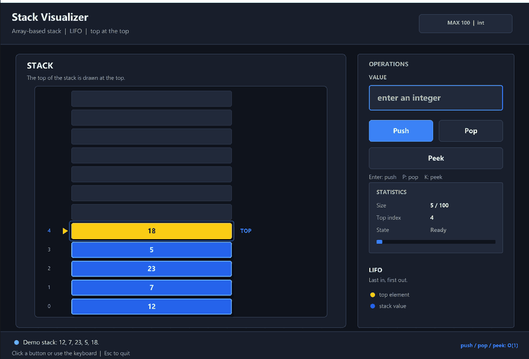

# Stack (Array Implementation) in C++

> Part of the [Data Structures and Algorithms in C++](../../README.md) collection.

## Overview

A **stack** is a linear data structure that follows **LIFO** (Last In, First Out) order: the most recently pushed element is the first one popped. This implementation uses a fixed-size array of 100 integers and an integer `top` that points to the last inserted element.

The implementation has two front ends: the original console menu in `stack.cpp`, and a **raylib GUI** in `gui.cpp` that uses a copy of the same stack operations from `stack.h`. The GUI adds a visual stack, push/pop animations, and a clean control panel without changing the original console program.

## Two Versions

This folder contains two completely separate front ends:

- **CLI version (`stack.cpp`)** — the original console program, written without AI. It is the reference implementation; use it to study how the stack is implemented in code (functions, array, `top`, overflow/underflow, menu loop).
- **UI version (`gui.cpp` + `stack.h`)** — a separate raylib program, generated entirely with AI as a visual copy of the CLI operations. It is the best place to see **what the stack does**: push/pop, LIFO order, the top element, empty/full states, and animations.

The two versions are independent: separate source files, separate executables (`stack.exe` vs `gui.exe`), and no runtime dependency. The CLI version is unchanged.

## Preview



*Push and pop animation in the UI version. The bottom-right corner shows the operation complexity.*

## Files

| File | Purpose |
| --- | --- |
| [`stack.cpp`](stack.cpp) | Original console program: array stack, operations, and menu (unchanged) |
| [`stack.h`](stack.h) | Header copy of the existing stack globals and functions, used by the GUI |
| [`gui.cpp`](gui.cpp) | raylib visualizer: stack drawing, input, and push/pop animations |
| [`build_gui.bat`](build_gui.bat) | Windows/MinGW build script for `gui.exe` |

## Build and Run

### Console version

```bash
g++ -std=c++17 stack.cpp -o stack
./stack
```

On Windows:

```powershell
g++ -std=c++17 stack.cpp -o stack.exe
.\stack.exe
```

> The console program calls `system("cls")` to clear the screen. That works on Windows; on Linux/macOS replace it with `system("clear")` in your local copy.

### GUI version

The GUI uses [raylib](https://www.raylib.com/) 6.2 and MinGW-w64 on Windows:

```bat
cd Data_structurs\stack
build_gui.bat
gui.exe
```

If raylib is installed elsewhere, set `RAYLIB_HOME` before building:

```bat
set RAYLIB_HOME=C:\path\to\raylib
build_gui.bat
```

The script outputs `gui.exe` in the same folder. It does not modify or rebuild the console `stack.exe`.

Optional runtime flags:

```bat
gui.exe --demo          REM start with a demo stack
gui.exe --smoke-test    REM draw 30 frames and exit
```

## How to Use

### Console menu

The menu has four options:

```text
Menu
1.push
2.pop
3.peek
4.exit
Enter The choice :
```

| Choice | Action | What it asks / prints |
| --- | --- | --- |
| `1` | Push | Asks for an integer, inserts it at the top, then prints the stack |
| `2` | Pop | Removes the top element, then prints the stack |
| `3` | Peek | Prints the current top value without removing it |
| `4` | Exit | Ends the program |

After push, pop, and peek the program waits for one character so you can read the result before the screen is cleared.

### Example session

```text
Menu
1.push
2.pop
3.peek
4.exit
Enter The choice :1
<<push>>
Enter the value :10

push is succesfully

stack : 10
Press any key to return:
```

After pushing `10`, `20`, and `30`, `display()` shows:

```text
stack : 10 20 30
```

`peek()` prints `30`. A `pop()` removes `30`, leaving `10 20`.

### GUI

The GUI shows the stack vertically: the bottom of the stack is at the bottom of the panel and the **top** is at the top. The top card is highlighted in yellow, empty slots are visible above it, and a `TOP` marker follows the top element.

| Action | Control |
| --- | --- |
| Push a value | Type an integer and press **Enter** or click **Push** |
| Pop | Click **Pop** or press **P** |
| Peek | Click **Peek** or press **K** |
| Quit | **Esc** or close the window |

The **Push** animation slides a new card in from the right. **Pop** moves the removed card out to the right and fades it. The right panel shows the current size, top index, state (Empty / Ready / Full), and a capacity bar. The bottom bar reports the result of the last operation.

## How It Works

### Shared operations

The functions and globals are defined exactly as before in `stack.cpp`. `stack.h` is a copy of those definitions created for the GUI, and `gui.cpp` includes it. The GUI calls the existing `push()`, `pop()`, and `peek()` functions, and reads `stack[]` and `top` only to draw the current state. No stack logic was changed.

`display()` is still used by the console version. The GUI does not call it because it draws the stack visually instead.

### Data representation

```cpp
const int MAX = 100;
int stack[MAX];
int top = -1;
```

`top == -1` means the stack is empty. When the stack contains `n` elements, `top == n - 1` and the valid elements are `stack[0]` through `stack[top]`.

```text
top = 2
+------+------+------+------+
|  10  |  20  |  30  |      |
+------+------+------+------+
   0      1      2      3
```

### `push(int value)`

1. Checks `top >= MAX - 1`. If true, the stack is full and the function returns `false`.
2. Increments `top`.
3. Stores `value` at `stack[top]`.
4. Returns `true`.

Time: **O(1)**.

### `pop()`

1. Checks `top == -1`. If true, the stack is empty and the function returns `false`.
2. Decrements `top`, which logically removes the top element.
3. Returns `true`.

The value itself is not returned or printed. The array slot still contains the old bytes, but it is outside the logical stack because `top` no longer includes it.

Time: **O(1)**.

### `peek()`

Checks for an empty stack and prints `stack[top]` if one exists. It does not modify `top`.

Time: **O(1)**.

### `display()`

Loops from index `0` to `top` and prints each element, so the output is ordered **bottom to top**:

```text
stack : 10 20 30
```

Time: **O(n)**, where `n` is the number of elements.

### `main()` (console)

The `while (1)` loop prints the menu, reads a choice, and dispatches it through a `switch`. After each operation it prints the boolean result, displays the stack, waits for a character, and clears the screen.

### GUI (`gui.cpp`)

The raylib program has a single screen with a top title bar, a stack panel, a controls panel, and a status bar:

- `update()` reads typed digits, the Enter/P/K keys, and the buttons. It calls the same `push()`, `pop()`, and `peek()` functions used by the console menu.
- `drawStackPanel()` draws 12 visible slots. If the stack has more than 12 elements, it shows the top 12 and reports how many are hidden below.
- Push and pop store an `Animation` with a start and end rectangle. The animation is visual only; the data structure is updated immediately by the existing functions.
- The GUI reads `stack[]` and `top` for rendering. It does not reimplement or modify any stack operation.

> The GUI code was generated with AI; the stack operations and console program are the author's original work. See the main [AI Assistance](../../README.md#ai-assistance) note.

## Complexity Summary

| Operation | Time | Space |
| --- | --- | --- |
| `push` | O(1) | O(1) |
| `pop` | O(1) | O(1) |
| `peek` | O(1) | O(1) |
| `display` | O(n) | O(1) |
| Entire stack | — | O(MAX) = O(100) |

## Notes and Limitations

- **Fixed capacity:** `MAX` is 100. There is no dynamic resizing.
- **GUI is a separate front end:** `gui.cpp` includes the copied operations in `stack.h`, while the original console program in `stack.cpp` remains unchanged.
- **AI-generated UI:** the raylib interface and animations were generated with AI; the stack operations are the author's original hand-written code.
- **Global state:** `stack` and `top` are global variables. A class-based version would keep them as members.
- **Pop does not return a value:** the console menu only reports success/failure. The GUI records the top value before calling `pop()` so it can animate the removed card.
- **Fixed element type:** only `int` values are supported.
- **Windows-only screen clearing:** the console `main()` uses `system("cls")`, while the `CLEAR` macro defined at the top is not actually used. The GUI does not use either.
- **Small cosmetic issue:** the console overflow message `"stack is full"` has no newline, so following output can appear on the same line.
- **No exception handling:** invalid console input is reported by the `default` branch, but non-numeric input can confuse `cin` and leave it in a failed state. The GUI only accepts digits and a leading minus sign.

## What This Teaches

- The relationship between `top` and the number of elements.
- Why push and pop are O(1) when the top is tracked directly.
- The difference between a logical size and the physical array capacity.
- Why overflow and underflow checks are required before every operation.
- How a simple array can implement an abstract data type without any dynamic memory allocation.
